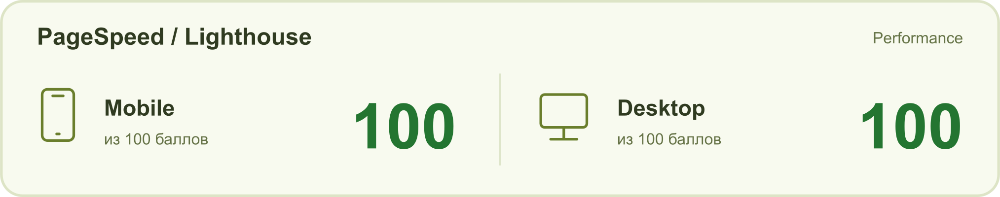

# Teaboom — карточка товара

Тестовое задание: адаптивная карточка «Ананасовый улун». HTML, CSS и JavaScript без фреймворков.

[Посмотреть страницу](https://teadrop-card.vercel.app/)

## Запуск

Откройте `index.html` в браузере. Зависимости и сборка не нужны.

Для запуска через локальный сервер можно использовать `npx serve .` из папки проекта.

## Файлы

- `index.html` — разметка.
- `styles.css` — готовые стили, которые подключены к странице.
- `css/` — те же стили, разделённые по блокам для удобства чтения.
- `product.js` — фасовки, артикулы, расчёт суммы и экономии, демонстрационная корзина.
- `ui.js` — меню, галерея, избранное и вкладки.
- `assets/` — изображения, локальные шрифты и их лицензии.

Корзина работает до перезагрузки страницы, backend не подключён. Отзывы — примеры для макета.
